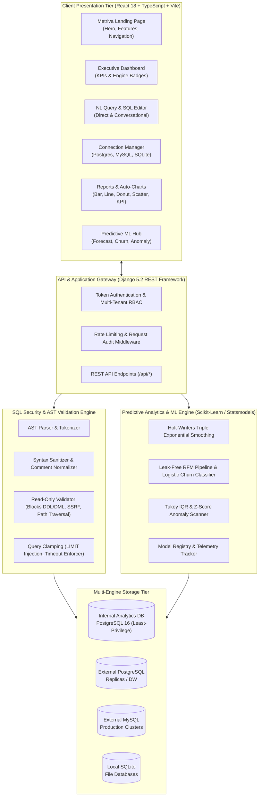

# Metriva

> Enterprise-grade conversational business intelligence, predictive machine learning, and safe natural language analytics for PostgreSQL, MySQL, and SQLite.

[](https://www.python.org/)
[](https://www.djangoproject.com/)
[](https://www.postgresql.org/)
[](https://react.dev/)
[](https://www.typescriptlang.org/)
[](https://vitejs.dev/)
[-success?logo=pytest&logoColor=white)](#testing--verification)
[-success?logo=vitest&logoColor=white)](#testing--verification)
[](#security--defense-in-depth)
[](LICENSE)

---

## 1. Executive Summary

**Metriva** is a production-grade conversational business intelligence and predictive analytics platform. It bridges the gap between non-technical stakeholders and complex relational databases by translating plain-English business inquiries into safe, optimized, and strictly validated SQL queries.

Unlike naive text-to-SQL prototypes that forward LLM outputs directly to database connections, Metriva implements a defense-in-depth security boundary: multi-engine database pooling, AST-based query token validation, schema table allowlists, read-only transaction clamping, and statement timeouts.

Beyond basic query execution, Metriva features an **automated visualization recommendation engine**, a **saved report and scheduling subsystem**, and a **predictive machine learning engine** (statistical Holt-Winters time-series forecasting, leak-free RFM churn classification, and Tukey IQR / Z-score anomaly alerting).

### Capability & Verification Scope

To maintain engineering transparency, Metriva distinguishes between verified operational components, offline mock modes, and cloud deployment boundaries:

| Dimension | Verified & Tested Status | Scope & Operational Boundary |
| :--- | :--- | :--- |
| **AST SQL Security Engine** | ✅ **100% Tested** (16 Security Checks) | Strict AST token validation, DDL/DML blocking, schema allowlists, transaction clamping (`READ ONLY`), and statement timeout injection. |
| **Internal PostgreSQL Demo DB** | ✅ **Live Verified** (PostgreSQL 16) | Migrations, demo dataset seeding (2,500 orders, 250 customers across 10 countries), pooling, and multi-tenant isolation verified live. |
| **External SQLite Datasource** | ✅ **Live Verified** (B2B SaaS Dataset) | External SQLite file attachment (15 enterprise SaaS accounts, 15 subscriptions, 13 invoices), schema introspection, AST-validated Direct SQL execution, and CSV export verified live. |
| **External MySQL Support** | 🔄 **Implemented (Live Test Pending)** | Driver (PyMySQL), connection encryption, schema discovery models, and SQL dialect handling implemented; independent live external server integration testing is pending dedicated container/host provisioning. |
| **BI & Predictive ML** | ✅ **100% Tested** (Unit & Integration) | Statistical Holt-Winters forecasting, RFM churn scoring, Tukey IQR / rolling Z-score anomalies, and automated chart recommendations. |
| **Dual-Theme Design System** | ✅ **100% Tested** (38 Vitest Tests) | 60 FPS HTML5 canvas animated hero, responsive light/dark themes, zero-FOUC initialization, and accessible reduced-motion support. |
| **AI Text-to-SQL: Mock Mode** | 🧪 **Offline Deterministic Mock** | Maps canonical business inquiries (revenue, churn, orders, top accounts) to valid SQL with zero API keys or external network traffic. |
| **AI Text-to-SQL: Open Domain** | ⚡ **Live Provider (Optional)** | Requires configuring `OPENAI_API_KEY` (GPT-4o / GPT-4o-mini) for arbitrary open-domain conversational synthesis. |
| **Production Infrastructure** | 📦 **Local & Docker Verified** | Containerized on Docker Compose (PostgreSQL 16, Django, React). Multi-node Kubernetes clustering and cloud TLS termination require infrastructure orchestration as detailed in [PRODUCTION_RUNBOOK.md](PRODUCTION_RUNBOOK.md). |

---

## 2. Architecture Overview



---

## 3. Core Capabilities

### 🔍 Conversational Natural Language to SQL & Direct SQL
- Translates natural-language business questions (e.g., *"Show the top 10 accounts by MRR"* or *"What was our monthly churn in 2026?"*) into ANSI/PostgreSQL/SQLite SQL.
- **Direct SQL Mode**: Data engineers can execute raw SQL directly against any connected datasource. Direct queries (`SELECT`/`WITH`) bypass prompt synthesis and preserve user-defined column projections, sorting, and row limits (e.g., `LIMIT 3`) intact while still passing through read-only AST safety validation.
- **Execution State & CSV Export**: Each query execution cleanses preceding result state, preventing stale data leakage. CSV exports immediately reflect the latest execution results and column headers.
- **AI Engine Architecture & Capabilities**:
  - *Zero-Cost Deterministic Mock Provider*: Built-in offline mock provider maps canonical business questions and schema identifiers to syntactically valid SQL with zero API keys or external network traffic.
  - *Live OpenAI Provider*: Set `OPENAI_API_KEY` to activate GPT-4o-mini / GPT-4o for open-domain natural-language reasoning.
  - *Current AI Limitations*: Mock mode is scoped to canonical analytical queries (revenue, churn, subscriptions, orders, top accounts). Complex open-domain conversational inquiries or arbitrary phrasing requires an active OpenAI API key.

### 🎨 Dual-Theme Design System & 3D Animated Hero
- **Complete Light & Dark Theme Support**: Built with semantic CSS custom properties and Tailwind CSS, featuring `light`, `dark`, and `system` synchronization with instant switching via the navbar `ThemeToggle`.
- **Zero-FOUC Initialization**: An inline `<head>` script inspects `localStorage` and OS `prefers-color-scheme` before the DOM renders, preventing unstyled light/dark flashes on page reloads.
- **Dynamic 3D-Inspired Canvas Hero**: High-performance HTML5 canvas renders 8 oscillating wireframe data pillars, a 3D perspective floor grid, particle sparks, and interactive mouse parallax at 60 FPS.
- **Accessibility & Reduced Motion**: Automatically detects `prefers-reduced-motion: reduce` to render a clean, low-power static wireframe layout without animation loops.
- **Reactive Recharts Theming**: Chart grids, Cartesian axes, tooltips, and bar/line strokes dynamically recalculate colors upon theme change without canvas artifacts.

### 🌐 Multi-Engine External DataSources
- Connects securely to **PostgreSQL**, **MySQL**, and **SQLite**.
  - *Verification Status*: Internal PostgreSQL (primary demo dataset) and external SQLite (B2B SaaS test database) are verified live end-to-end. MySQL driver integration, schema models, and AST validation are implemented in the codebase; independent live external MySQL server integration testing is pending dedicated container/host provisioning.
- **Fernet Symmetric Encryption**: Sensitive database credentials (passwords, hosts, tokens) are encrypted at rest using Fernet (128-bit AES in CBC mode with HMAC-SHA256 authenticated encryption) derived from the application key.
- **Dynamic Schema Introspection**: Extracts schema tables, columns, data types, and foreign key relationships with intelligent caching.
- **Fine-Grained Table Allowlists**: Administrators can restrict the AI to specific approved tables, preventing access to sensitive schemas (e.g., auth tokens, payroll).

### 🛡️ Multi-Layer Security & Defense-in-Depth
- **Strict Read-Only Enforcement**: Blocks all destructive commands (`DROP`, `DELETE`, `UPDATE`, `ALTER`, `TRUNCATE`, `INSERT`, `GRANT`, `REVOKE`).
- **SQL AST Token Analysis**: Rejects statement chaining (semicolon splitting), comments designed to hide payloads (`/* ... */`, `--`), and MySQL executable comments (`/*!50000 ... */`).
- **SSRF & Network Boundary Protection**: Rejects cloud metadata addresses (`169.254.169.254`, `metadata.google.internal`), loopback addresses, and unauthorized infrastructure ports.
- **SQLite Path Traversal Safeguards**: Rejects system directory paths (`/etc`, `/proc`, `/sys`, `/var`) and path traversal sequences (`../`, null bytes).
- **PostgreSQL Least Privilege**: Enforces `statement_timeout = 10s`, `idle_in_transaction_session_timeout = 5s`, and non-superuser database roles.

### 📊 Conversational Business Intelligence & Automated Visualizations
- **Automatic Chart Recommender**: Analyzes returned result schemas to select optimal chart types:
  - *Bar Charts* for discrete category revenue comparisons.
  - *Trend Lines* for time-series date sequences.
  - *Donut / Pie Charts* for part-to-whole proportions.
  - *Scatter Plots* for bivariate correlation analysis.
  - *KPI Cards* for single-value summaries.
- **Saved Reports & Schedules**: Save any natural language query or SQL result as a reusable report with automated execution schedules (Daily, Weekly, Monthly) and in-app delivery.

### 🤖 Predictive Analytics & Real Machine Learning
- **Time-Series Revenue Forecasting**: Uses Holt-Winters Triple Exponential Smoothing with additive seasonality, computing in-sample MAE/RMSE and generating 95% confidence prediction bands.
- **Customer Churn Risk Radar**: Builds leak-free Recency, Frequency, and Monetary (RFM) feature pipelines evaluated on historical cutoff boundaries to train calibrated logistic regression classifiers with precision, recall, and confusion matrix telemetry.
- **Multi-Algorithm Anomaly Detection**: Employs Tukey IQR outlier analysis and rolling Z-score thresholds to detect spike, drop, and anomalous transactions with automated alert escalation.
- **Epistemic Taxonomy for AI Insights**: Summaries are strictly categorized into:
  - *Observed Historical Facts*
  - *Predictive Estimates*
  - *Statistical Associations*
  - *Investigation Hypotheses*

---

## 4. Technology Stack

| Layer | Technologies |
| :--- | :--- |
| **Frontend** | React 18, TypeScript 5.5, Vite 5, Tailwind CSS, Recharts, Lucide Icons |
| **Frontend Testing** | Vitest 2.1, React Testing Library, JSDOM, User Event |
| **Backend** | Python 3.14 / 3.12, Django 5.2, Django REST Framework |
| **Backend Testing** | Pytest 9.1, Pytest-Django, Ruff Linter & Formatter |
| **Databases** | PostgreSQL 16 (Primary), MySQL 8 (External), SQLite 3 (External) |
| **Machine Learning** | Scikit-Learn, Statsmodels, NumPy, Pandas |
| **Security & Crypto** | Cryptography (Fernet), SQLParse AST Analyzer |
| **Containerization** | Docker, Docker Compose, Multi-stage builds |

---

## 5. Testing & Verification

The codebase has undergone exhaustive testing across unit, integration, security, and end-to-end workflows:

| Test Suite | Framework | Target / Focus | Passed | Status |
| :--- | :--- | :--- | :---: | :---: |
| **Backend Suite** | Pytest 9.1 | Models, Serializers, Views, Validators, External DataSources, ML | **149 / 149** | ✅ PASS |
| **Security Hardening** | Pytest 9.1 | SSRF, Path Traversal, AST Splitting, Tenant Isolation | **16 / 16** | ✅ PASS |
| **E2E Acceptance** | Pytest 9.1 | Full 19-Step End-to-End Business Pipeline | **1 / 1** | ✅ PASS |
| **Frontend Suite** | Vitest 2.1 | Metriva Design System, RTL Components, Landing, Connections, Query | **38 / 38** | ✅ PASS |
| **Python Linter** | Ruff | PEP 8, Unused Imports, Code Style | **Clean (0 errors)** | ✅ PASS |
| **Frontend Build** | TypeScript / Vite | `tsc && vite build` bundle compilation | **Clean (0 errors)** | ✅ PASS |

---

## 6. Quick Start & Local Setup

### Option A: Running with Docker Compose (Recommended)

1. **Clone the repository**:
   ```bash
   git clone https://github.com/your-username/ai-database.git
   cd "ai-database"
   ```

2. **Configure environment**:
   ```bash
   cp .env.example .env
   ```

3. **Start the containers**:
   ```bash
   docker compose up --build -d
   ```

4. **Verify container health**:
   ```bash
   docker compose ps
   ```
   - Frontend UI: `http://localhost:5173`
   - Backend API: `http://localhost:8000`
   - Liveness Health: `http://localhost:8000/api/health/`
   - Readiness Probe: `http://localhost:8000/api/ready/`

---

### Option B: Local Native Development

#### Backend Setup
```bash
# 1. Create and activate virtual environment
python3 -m venv .venv
source .venv/bin/activate

# 2. Install dependencies
pip install -r backend/requirements.txt

# 3. Configure environment variables
export DJANGO_SETTINGS_MODULE="config.settings"
export DB_ENGINE="django.db.backends.postgresql"
export DB_NAME="aidb"
export DB_USER="aidb_user"
export DB_PASSWORD="aidb_secure_password"
export DB_HOST="localhost"
export DB_PORT="5432"

# 4. Run migrations and start server
python backend/manage.py migrate
python backend/manage.py runserver 0.0.0.0:8000
```

#### Frontend Setup
```bash
# 1. Navigate to frontend directory
cd frontend

# 2. Install dependencies
npm install

# 3. Run frontend unit and smoke tests
npm test

# 4. Start Vite development server
npm run dev
```

---

## 7. Verified Database Datasets

> [!NOTE]
> All demonstration datasets in PostgreSQL and SQLite are completely **synthetic**, generated deterministically for testing and evaluation. They contain zero real customer PII, corporate secrets, or actual financial records.

### A. Demo PostgreSQL Transactional Dataset
Metriva includes a deterministic, production-scale synthetic seed command:
```bash
python backend/manage.py seed_database --scale standard
```
- **Customers**: 250 synthetic records (Enterprise, SMB, Consumer segments across 10 countries)
- **Products**: 100 products categorized across Software, Hardware, and Infrastructure
- **Orders**: 2,500 synthetic transactional orders spanning 24 historical months
- **Order Items**: 6,234 line items
- **Payments**: 2,500 synthetic payment settlement records (Credit Card, Wire, ACH)
- **Website Events**: 5,000 synthetic clickstream events (Page views, Cart additions, Checkouts)

### B. Isolated External SQLite Test Dataset
A standalone synthetic B2B subscription database (`test_business_db.sqlite3`) for external datasource verification:
```bash
python backend/scripts/seed_test_business_db.py
```
- **Accounts**: 15 synthetic enterprise SaaS accounts across FinTech, HealthTech, AI, and Cybersecurity
- **Subscriptions**: 15 synthetic active/paused/cancelled subscriptions across Starter, Growth, and Enterprise tiers
- **Invoices**: 13 synthetic billing records with payment statuses, line items, and MRR tracking

---

## 8. Application Showcase & Screenshots

| View | Dark Theme | Light Theme |
| :--- | :--- | :--- |
| **Metriva Landing Page** |  |  |
| **Executive Dashboard** |  |  |
| **Natural Language & Direct SQL** |  |  |
| **Database Connections Manager** |  |  |
| **Mobile Experience (390px)** |  |  |
| **Predictive Analytics Hub** |  | — |
| **Schema Explorer** |  | — |

---

## 9. Documentation Index

- [External Database Connection Guide](docs/EXTERNAL_DATABASE_GUIDE.md) — Step-by-step setup for PostgreSQL, MySQL, and SQLite.
- [Production Runbook](PRODUCTION_RUNBOOK.md) — Production operations, deployment, and emergency response.
- [System Architecture](docs/architecture.md) — Comprehensive architectural breakdown and design decisions.
- [Database Performance & Optimization](docs/database-performance.md) — Indexes, query plans, and CTE strategies.
- [Security Specifications](docs/security.md) — AST validation rules, SSRF mitigation, and least-privilege configurations.
- [REST API Reference](docs/api.md) — Endpoints, payloads, and response structures.

---

## 10. License

Metriva is released under the [Business Source License 1.1 (BSL 1.1)](LICENSE), Copyright © 2026 Maryam Abdul Karim.

- **Non-Production & Evaluation:** You may freely copy, modify, redistribute, test, and evaluate Metriva for non-production purposes.
- **Internal Business Use:** You are affirmatively licensed to use Metriva in production for your internal business operations and analytics.
- **Commercial SaaS Restriction:** You may not use Metriva to provide a commercial managed service, hosted software-as-a-service (SaaS), or cloud database assistant to third parties.
- **Change License:** On October 24, 2030 (the fourth anniversary of first public distribution), Metriva automatically converts to the [Apache License, Version 2.0](https://www.apache.org/licenses/LICENSE-2.0).

See [LICENSE](LICENSE) for the complete license terms and [THIRD_PARTY_NOTICES.md](THIRD_PARTY_NOTICES.md) for third-party dependency notices and acknowledgments.
