# Metriva

> Enterprise-ready conversational business intelligence, predictive machine learning, multi-tenant RBAC, and column-level data protection for PostgreSQL, MySQL, and SQLite.

[](https://github.com/maryamabdulkarim361-lab/Metriva/actions/workflows/tests.yml)
[](https://www.python.org/)
[](https://www.djangoproject.com/)
[](https://www.postgresql.org/)
[](https://www.mysql.com/)
[](https://react.dev/)
[](https://www.typescriptlang.org/)
[](https://vitejs.dev/)
[](#5-testing--verification)
[](#5-testing--verification)
[](#5-testing--verification)
[-blue)](LICENSE)

---

## 1. Executive Summary

**Metriva** is an enterprise-ready conversational business intelligence, predictive analytics, and secure data access platform. It empowers business analysts, engineering teams, and executive stakeholders to safely query, visualize, and forecast complex relational databases using natural language or direct SQL.

Unlike naive text-to-SQL prototypes that stream raw LLM output into unconstrained database connections, Metriva establishes a robust defense-in-depth boundary:
- **Enterprise Multi-Tenant RBAC:** Granular role enforcement (`ADMIN`, `ANALYST`, `VIEWER`) with organization-scoped data isolation across database connections, query histories, saved reports, and ML jobs.
- **Dynamic Column-Level Data Masking:** Automated redaction of sensitive business fields (emails, phone numbers, account identifiers, monetary values) paired with AST-level query guards that intercept filter- or sort-based side-channel leakage vectors.
- **SQL Abstract Syntax Tree (AST) Security:** Lexical token validation, read-only transaction clamping (`SET TRANSACTION READ ONLY`), statement timeouts, and schema allowlists blocking DDL/DML, multi-statement injection, and SSRF attacks.
- **Multi-Engine Relational Data Access:** Unified connection pooling and schema introspection across PostgreSQL 16, MySQL 8.4 LTS, and SQLite 3.
- **Predictive Machine Learning:** In-database statistical Holt-Winters time-series forecasting, leak-free RFM churn classification, and Tukey IQR / rolling Z-score anomaly detection.

### Capability & Verification Scope

To maintain complete engineering transparency, Metriva documents verified operational components, offline deterministic mock modes, and cloud deployment boundaries:

| Dimension | Verified & Tested Status | Scope & Operational Boundary |
| :--- | :--- | :--- |
| **Enterprise RBAC & Tenancy** | ✅ **100% Tested** (23 Tests) | Strict server-side tenancy clamping, 3-tier role hierarchy (`ADMIN`, `ANALYST`, `VIEWER`), immediate membership revocation, and zero cross-tenant leakage. |
| **Column Masking & AST Guard** | ✅ **100% Tested** (Unit & Integration) | Policy-driven dynamic regex masking (`mask_email`, `mask_phone`, `mask_partial_account`, `nullify`) and AST parser rejection of sensitive column predicates in `WHERE`, `ORDER BY`, and `GROUP BY`. |
| **AST SQL Security Engine** | ✅ **100% Tested** (16 Security Checks) | Strict AST token validation, DDL/DML blocking, schema allowlists, transaction clamping (`READ ONLY`), and statement timeout injection. |
| **Internal PostgreSQL Demo DB** | ✅ **Live Verified** (PostgreSQL 16) | Migrations, deterministic synthetic seed dataset (2,500 orders, 250 customers across 10 countries), connection pooling, and multi-tenant isolation. |
| **External MySQL Integration** | ✅ **Live Verified** (12 Live Tests) | Dedicated containerized MySQL 8.4 service, synthetic supply chain dataset (10 suppliers, 12 inventory SKUs, 10 shipments), least-privilege read-only user (`metriva_readonly`), AST validation, and RFC 4180 CSV export. |
| **External SQLite Datasource** | ✅ **Live Verified** (B2B SaaS Dataset) | External SQLite file attachment (15 enterprise SaaS accounts, 15 subscriptions, 13 invoices), schema introspection, AST-validated Direct SQL execution, and CSV export. |
| **BI & Predictive ML** | ✅ **100% Tested** (Unit & Integration) | Statistical Holt-Winters forecasting, leak-free RFM churn scoring, Tukey IQR / rolling Z-score anomalies, and automated chart recommendations. |
| **Dual-Theme Design System** | ✅ **100% Tested** (47 Vitest Tests) | 60 FPS HTML5 canvas animated hero, responsive light/dark themes, zero-FOUC initialization, and accessible reduced-motion support. |
| **AI Text-to-SQL: Mock Mode** | 🧪 **Offline Deterministic Mock** | Maps canonical business inquiries (revenue, churn, orders, top accounts) to valid SQL with zero API keys or external network traffic. |
| **AI Text-to-SQL: Open Domain** | ⚡ **Live Provider (Optional)** | Requires configuring `OPENAI_API_KEY` (GPT-4o / GPT-4o-mini) for arbitrary open-domain conversational synthesis. |
| **Production Infrastructure** | 📦 **Local & Docker Verified** | Containerized on Docker Compose (PostgreSQL 16, MySQL 8.4, Django, React). Multi-node Kubernetes clustering and cloud TLS termination require infrastructure orchestration as detailed in [PRODUCTION_RUNBOOK.md](PRODUCTION_RUNBOOK.md). |

---

## 2. Architecture Overview

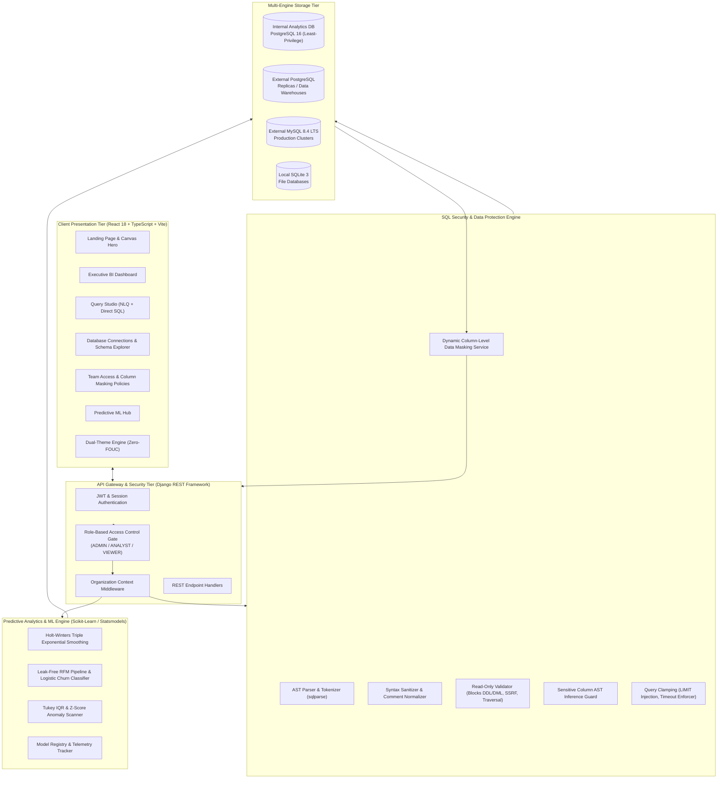

---

## 3. Core Capabilities

### 🔐 Enterprise RBAC & Multi-Tenant Isolation
- **3-Tier Hierarchical Roles**:
  - `ADMIN`: Full organizational governance, member onboarding, datasource credential management, table allowlists, and column masking policy administration.
  - `ANALYST`: Natural language query generation, Direct SQL execution, saved report authoring, and asynchronous ML job execution. Query results are dynamically masked according to organizational policies.
  - `VIEWER`: Restricted strictly to pre-approved executive dashboards, saved reports, and certified analytics. Viewers cannot execute arbitrary SQL or AI queries, nor trigger unmonitored model runs.
- **Server-Side Tenant Clamping**: All database queries, query histories, saved reports, database credentials, and ML runs are scoped to the authenticated user's active organization. Cross-organization access is strictly rejected at the ORM layer.
- **New-User Onboarding & Demo Isolation**: Newly registered organizations without connected external databases enter a clean onboarding state with zero datasources and zero query history leaks. Shared synthetic benchmark metrics are displayed strictly in an explicit, clearly labeled sample mode.
- **Immediate Role Revocation**: Revoking membership or downgrading roles invalidates access tokens and session context immediately without stale permission caching.

### 🛡️ Dynamic Column-Level Data Masking & AST Inference Mitigation
- **Dynamic Response Masking**: Sensitive customer and corporate fields are automatically masked based on active organization policies:
  - `mask_email`: `j***e@domain.com` (preserves domain structure while concealing identity)
  - `mask_phone`: `***-***-1234` (preserves terminal digits for reconciliation)
  - `mask_partial_account`: `****-5678` (protects credit cards, account numbers, and SSNs)
  - `nullify`: Returns `NULL` for unauthorized financial or salary figures
- **AST-Level Inference Mitigation**: Naive column masking often exposes sensitive values to statistical extraction via query filters or ordering. Metriva's `SQLValidator` inspects the query Abstract Syntax Tree using `sqlparse` to intercept and reject queries where non-Admin users reference masked columns inside `WHERE`, `ON`, `HAVING`, `ORDER BY`, or `GROUP BY` clauses, mitigating binary-search and side-channel inference vectors.

### 🌐 Multi-Engine Relational Data Access
- **PostgreSQL 16**: Primary internal transactional database and external analytics target with connection pooling and schema introspection.
- **MySQL 8.4 LTS**: Dedicated external database integration supporting secure socket communication, least-privilege read-only credentials (`metriva_readonly`), schema table allowlists, and RFC 4180 CSV streaming.
- **SQLite 3**: Standalone file-based database support with path traversal safeguards (`/etc`, `/proc`, `../` blocking) and memory-isolated schema discovery.
- **Credential Protection**: Database passwords and connection URIs are encrypted at rest using Fernet symmetric cryptography (128-bit AES-CBC with HMAC-SHA256 authentication).

### 🔍 Conversational Natural Language to SQL & Direct SQL
- **Dual Query Modalities**:
  - *Conversational Mode*: Translates natural language questions (*"What was our monthly churn in Q3?"*, *"Show top 10 enterprise accounts by MRR"*) into syntactically valid ANSI/PostgreSQL/MySQL SQL.
  - *Direct SQL Mode*: Engineers and analysts can author and run raw SQL against any connected database with full preservation of custom projections, joins, and row limits.
- **Deterministic Mock Provider**: Includes a built-in offline mock provider mapping canonical analytical questions to schema queries with zero external network traffic or API cost.
- **Query Result Lifecycle & Export**: Execution state is strictly partitioned per execution; stale query buffers are wiped prior to execution. RFC 4180 compliant CSV exports stream real-time masked data directly to client sessions.

### 🎨 Dual-Theme Design System & 3D Animated Hero
- **Light & Dark Mode**: Full semantic theme support with instantaneous switching via the navbar `ThemeToggle`.
- **Zero-FOUC Initialization**: Pre-render inline script reads `localStorage` and OS `prefers-color-scheme` to prevent unstyled white/dark flashes on page load.
- **60 FPS Canvas Hero**: High-performance HTML5 canvas renders 8 oscillating wireframe pillars, a 3D perspective floor grid, and interactive mouse parallax, with automatic fallback for `prefers-reduced-motion`.
- **Dynamic Recharts Theming**: Cartesian grids, axes, tooltips, and bar/line strokes dynamically recalculate colors upon theme change.

### 🤖 Predictive Analytics & Real Machine Learning
- **Holt-Winters Forecasting**: Triple exponential smoothing with additive seasonality, computing in-sample MAE/RMSE and generating 95% confidence intervals.
- **Leak-Free RFM Churn Classifier**: Recency, Frequency, and Monetary feature pipelines evaluated strictly on historical cutoff dates to train calibrated logistic regression classifiers with precision, recall, and ROC-AUC telemetry.
- **Multi-Algorithm Anomaly Detection**: Employs Tukey IQR outlier analysis and rolling Z-score thresholds to detect volume spikes, transaction drops, and anomalous ledger entries.
- **Epistemic AI Insight Taxonomy**: Categorizes analytical summaries into Observed Historical Facts, Predictive Estimates, Statistical Associations, and Investigation Hypotheses.

---

## 4. Technology Stack

| Layer | Technologies |
| :--- | :--- |
| **Frontend** | React 18, TypeScript 5.5, Vite 5, Tailwind CSS, Recharts, Lucide Icons |
| **Frontend Testing** | Vitest 2.1, React Testing Library, JSDOM, User Event |
| **Backend** | Python 3.14 / 3.12, Django 5.2, Django REST Framework |
| **Backend Testing** | Pytest 9.1, Pytest-Django, Ruff Linter & Formatter |
| **Databases** | PostgreSQL 16 (Primary), MySQL 8.4 LTS (External), SQLite 3 (External) |
| **Machine Learning** | Scikit-Learn, Statsmodels, NumPy, Pandas |
| **Security & AST** | Cryptography (Fernet), sqlparse AST Analyzer |
| **Containerization** | Docker, Docker Compose, Multi-stage builds |

---

## 5. Testing & Verification

The codebase has undergone exhaustive automated testing across unit, integration, security, and live external service boundaries. All tests run in continuous integration on GitHub Actions:

| Test Suite | Framework | Target / Focus | Unique Tests | Status |
| :--- | :--- | :--- | :---: | :---: |
| **Backend Test Suite (Total)** | Pytest 9.1 | Comprehensive API, ORM, RBAC, AST, ML, and Datasource suites | **187 / 187** | ✅ PASS |
| ↳ *RBAC & Data Protection* | Pytest 9.1 | Multi-tenant isolation, role hierarchy, dynamic masking | *26 / 26* | ✅ PASS |
| ↳ *Security Hardening Suite* | Pytest 9.1 | SSRF, Path Traversal, AST Splitting, Wildcard & Permission Guards | *16 / 16* | ✅ PASS |
| ↳ *MySQL 8.4 Live Integration* | Pytest 9.1 | Genuine MySQL 8.4 Server, Schema Introspection, Read-Only User | *12 / 12* | ✅ PASS |
| ↳ *SQL AST Validator Suite* | Pytest 9.1 | Lexical token parsing, syntax sanitizing, DDL/DML blocking | *55 / 55* | ✅ PASS |
| **Frontend Test Suite (Total)** | Vitest 2.1 | Components, Navigation, Query Studio, RBAC Guards, Onboarding & Session Isolation | **54 / 54** | ✅ PASS |
| **Python Linter** | Ruff | PEP 8, Import hygiene, Static analysis | **Clean (0 errors)** | ✅ PASS |
| **TypeScript / Frontend Build** | TypeScript / Vite | Strict typechecking (`tsc`) and production bundle compilation | **Clean (0 errors)** | ✅ PASS |
| **CI Workflow Pipeline** | GitHub Actions | Automated Ubuntu test runner with PostgreSQL & MySQL services | **100% Passing** | ✅ PASS |

**Unique Automated Tests:** **241 unique automated tests** (187 backend and 54 frontend), all passing (100%), with dedicated coverage for live MySQL 8.4 integration (12 tests) and security hardening (16 checks).

---

## 6. Quick Start & Local Setup

### Option A: Running with Docker Compose (Recommended)

1. **Clone the repository**:
   ```bash
   git clone https://github.com/maryamabdulkarim361-lab/Metriva.git
   cd Metriva
   ```

2. **Configure environment**:
   ```bash
   cp .env.example .env
   ```

3. **Start services with Docker Compose**:
   ```bash
   # Starts PostgreSQL 16, MySQL 8.4 LTS, Django Backend, and React Frontend
   docker compose up --build -d
   ```

4. **Verify container health**:
   ```bash
   docker compose ps
   ```
   - Frontend UI: `http://localhost:5173`
   - Backend API: `http://localhost:8000`
   - Health Probe: `http://localhost:8000/api/health/`

---

### Option B: Local Native Development

#### 1. Backend Setup
```bash
# Create and activate virtual environment
python3 -m venv .venv
source .venv/bin/activate

# Install dependencies
pip install -r backend/requirements.txt

# Configure environment variables
export DJANGO_SETTINGS_MODULE="config.settings"
export DB_ENGINE="django.db.backends.sqlite3"
export DB_NAME="db.sqlite3"

# Run migrations and seed synthetic demonstration data
python backend/manage.py migrate
python backend/manage.py seed_database --scale standard

# Start development server
python backend/manage.py runserver 0.0.0.0:8000
```

#### 2. Frontend Setup
```bash
# Navigate to frontend directory
cd frontend

# Install dependencies
npm install

# Run frontend tests
npm test

# Start Vite development server
npm run dev
```

---

## 7. Verified Database Datasets

> [!NOTE]
> All demonstration datasets in PostgreSQL, MySQL, and SQLite are completely **synthetic**, generated deterministically for testing and evaluation. They contain zero real customer PII, corporate secrets, or actual financial records.

### A. Demo PostgreSQL Transactional Dataset
Metriva includes a deterministic synthetic seed command:
```bash
python backend/manage.py seed_database --scale standard
```
- **Customers**: 250 synthetic records (Enterprise, SMB, Consumer segments across 10 countries)
- **Products**: 100 products categorized across Software, Hardware, and Infrastructure
- **Orders**: 2,500 synthetic transactional orders spanning 24 historical months
- **Order Items**: 6,234 line items
- **Payments**: 2,500 synthetic payment settlement records (Credit Card, Wire, ACH)
- **Website Events**: 5,000 synthetic clickstream events (Page views, Cart additions, Checkouts)

### B. Isolated External SQLite Test Dataset
A standalone synthetic B2B subscription database (`test_business_db.sqlite3`) for external datasource verification:
```bash
python backend/scripts/seed_test_business_db.py
```
- **Accounts**: 15 synthetic enterprise SaaS accounts across FinTech, HealthTech, AI, and Cybersecurity
- **Subscriptions**: 15 synthetic active/paused/cancelled subscriptions across Starter, Growth, and Enterprise tiers
- **Invoices**: 13 synthetic billing records with payment statuses, line items, and MRR tracking

### C. Dedicated MySQL 8.4 Supply Chain Dataset
An external MySQL database initialized via `database/mysql/init_metriva_mysql.sql`:
- **Suppliers**: 10 global supply chain vendors
- **Inventory SKUs**: 12 warehouse product inventory records
- **Shipments**: 10 fulfillment tracking records
- **Access Account**: Dedicated read-only user (`metriva_readonly`) restricted to `SELECT` privileges only.

---

## 8. Application Showcase & Screenshots

| View | Dark Theme | Light Theme |
| :--- | :--- | :--- |
| **Metriva Landing Page** | 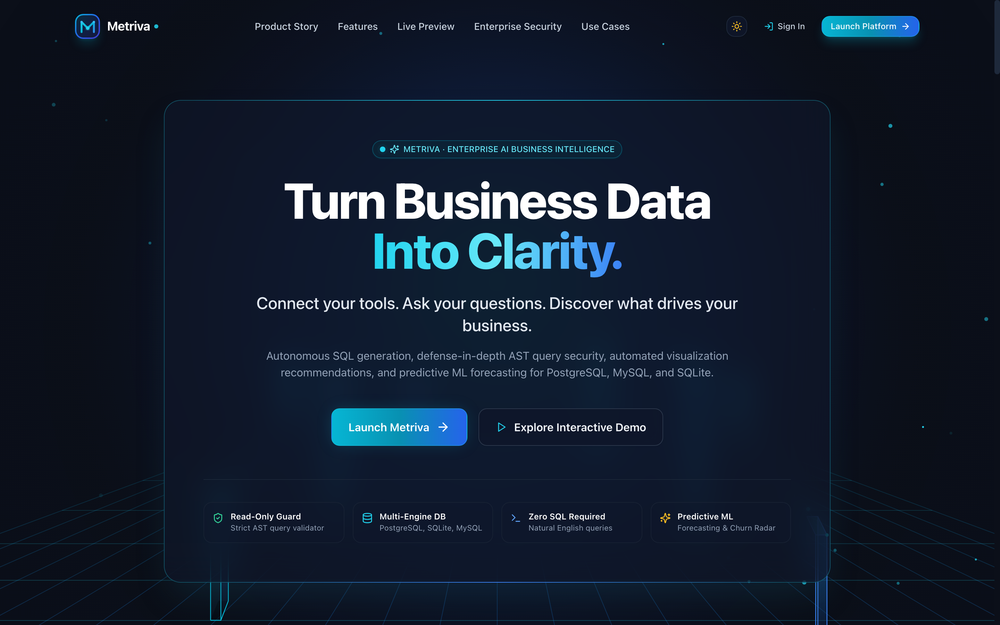 | 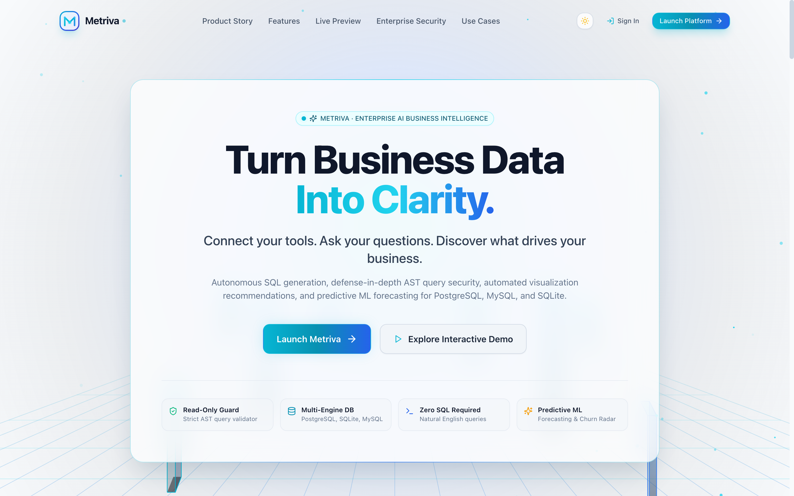 |
| **Executive Dashboard** | 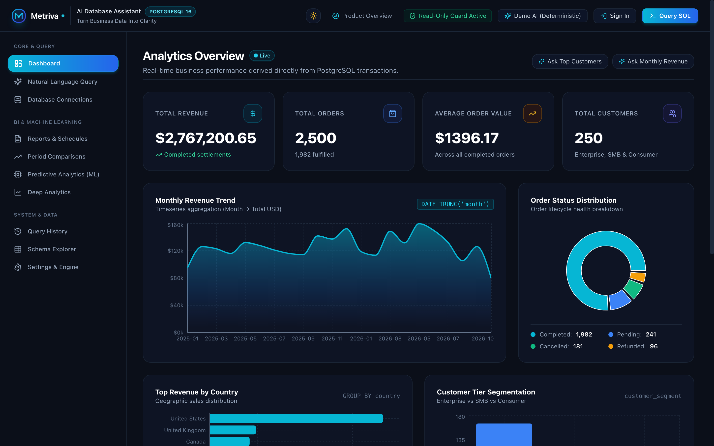 | 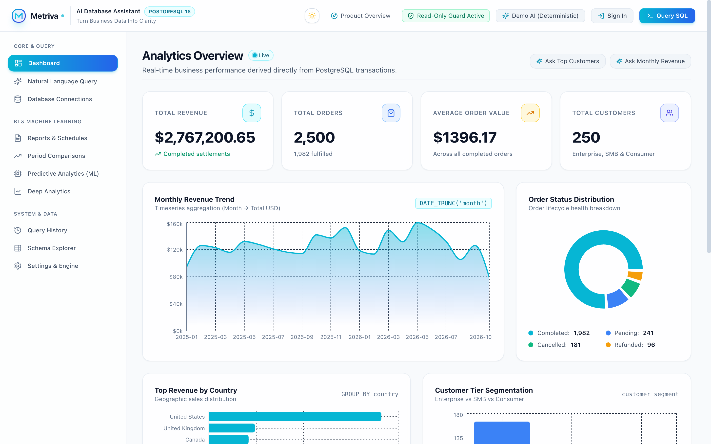 |
| **Natural Language & Direct SQL** | 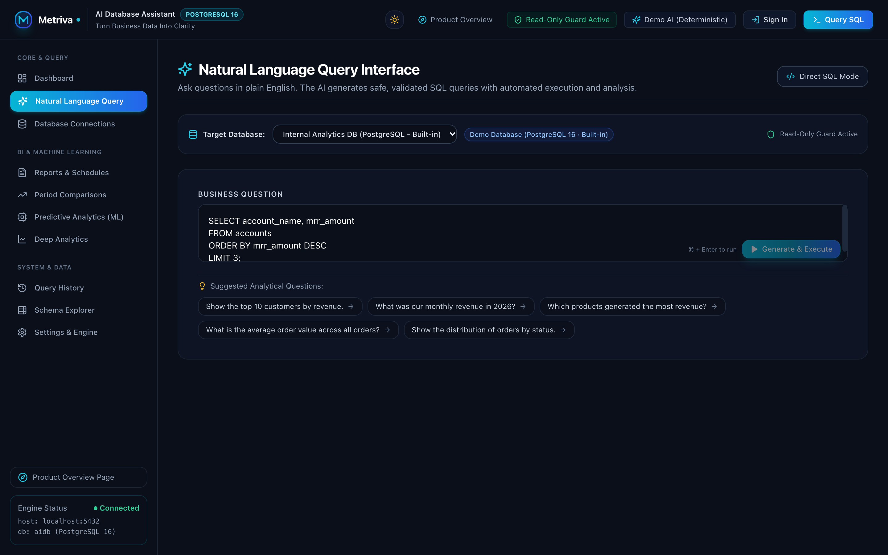 | 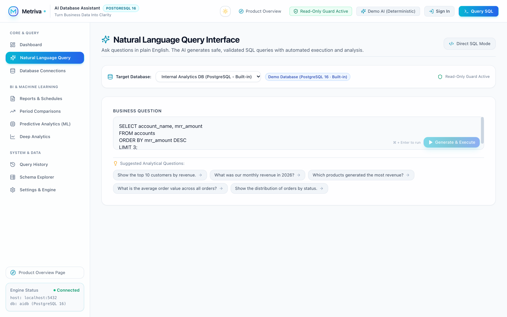 |
| **Database Connections Manager** | 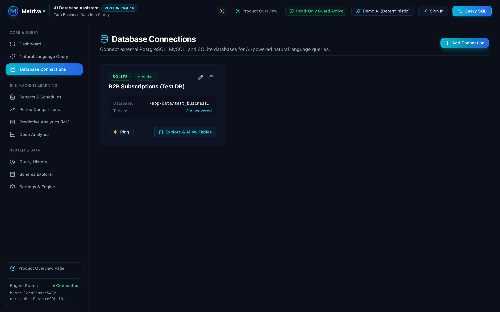 | 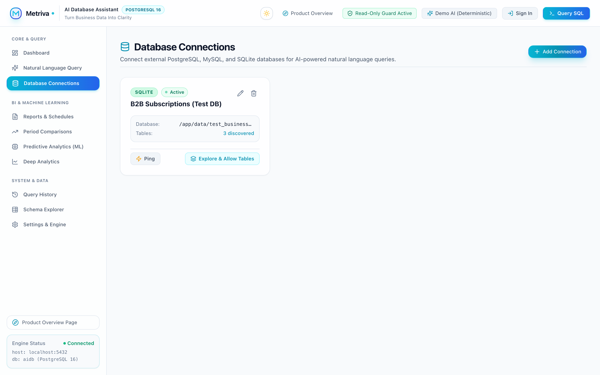 |
| **Mobile Experience (390px)** | 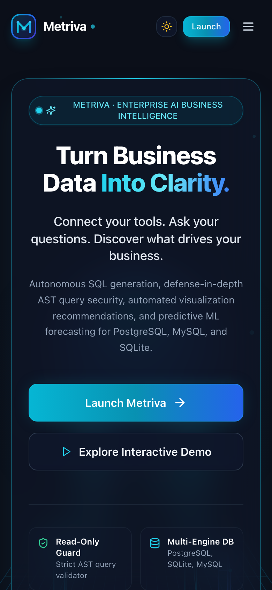 | 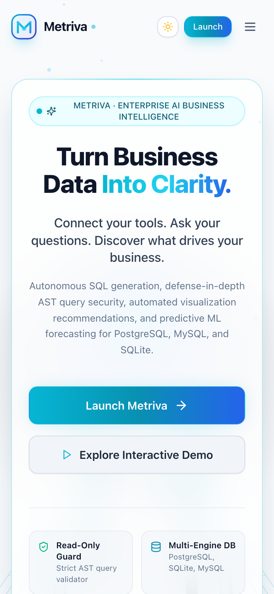 |
| **Predictive Analytics Hub** | 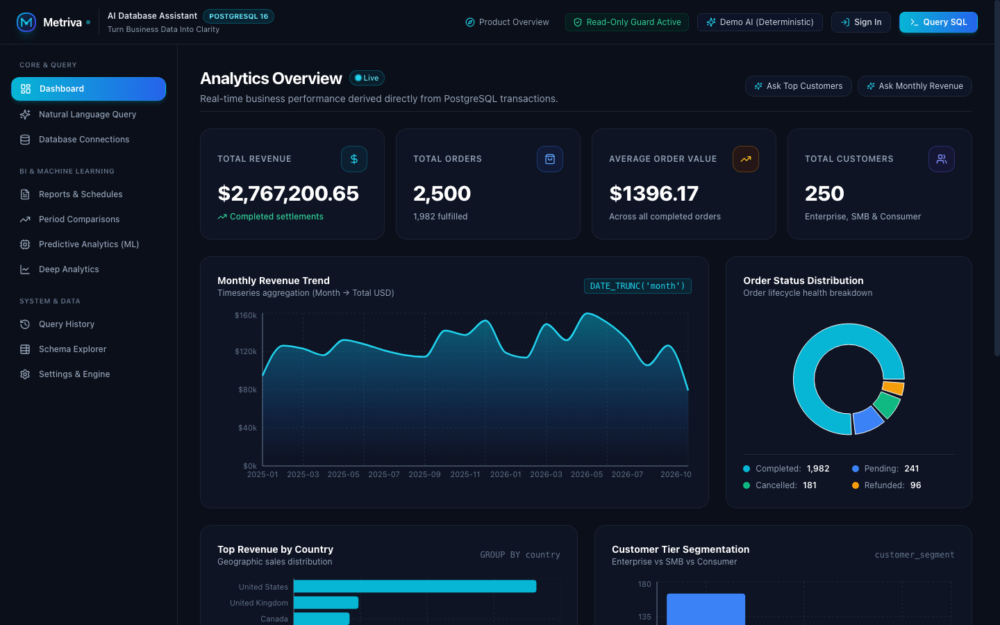 | — |
| **Schema Explorer** |  | — |

---

## 9. Documentation Index

- [External Database Connection Guide](docs/EXTERNAL_DATABASE_GUIDE.md) — Step-by-step setup for PostgreSQL, MySQL, and SQLite.
- [Production Runbook](PRODUCTION_RUNBOOK.md) — Production operations, deployment, and emergency response.
- [System Architecture](docs/architecture.md) — Comprehensive architectural breakdown and design decisions.
- [Database Performance & Optimization](docs/database-performance.md) — Indexes, query plans, and CTE strategies.
- [Security Specifications](docs/security.md) — AST validation rules, SSRF mitigation, and least-privilege configurations.
- [REST API Reference](docs/api.md) — Endpoints, payloads, and response structures.

---

## 10. License

Metriva is released under the [Business Source License 1.1 (BSL 1.1)](LICENSE), Copyright © 2026 Maryam Abdul Karim.

Metriva is **source-available** software under the Business Source License 1.1 (BSL 1.1), not an OSI-approved open source license:
- **Non-Production & Evaluation:** You may freely copy, modify, redistribute, test, and evaluate Metriva for non-production purposes.
- **Internal Business Use:** You are affirmatively licensed to use Metriva in production for your internal business operations and analytics.
- **Commercial SaaS Restriction:** You may not use Metriva to provide a commercial managed service, hosted software-as-a-service (SaaS), or cloud database assistant to third parties.
- **Change License:** On October 24, 2030 (the fourth anniversary of first public distribution), Metriva automatically converts to the [Apache License, Version 2.0](https://www.apache.org/licenses/LICENSE-2.0).

See [LICENSE](LICENSE) for the complete license terms and [THIRD_PARTY_NOTICES.md](THIRD_PARTY_NOTICES.md) for third-party dependency notices and acknowledgments.
