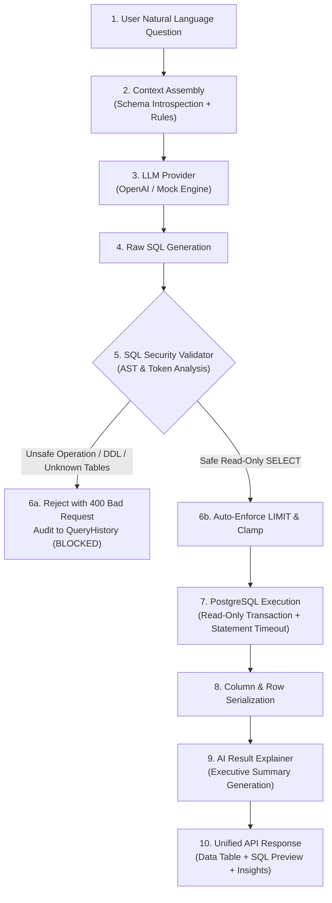

# AI Natural Language to SQL Pipeline

The AI Natural Language to SQL Pipeline converts unstructured business inquiries into high-performance, safe PostgreSQL queries, executes them in isolated transactions, and synthesizes the tabular output into natural language business insights.

---

## 1. Pipeline Architecture



---

## 2. Pluggable Provider Architecture

The AI layer is abstracted behind the abstract base class `LLMProvider`:

```python
class LLMProvider(ABC):
    @abstractmethod
    def generate_sql(self, question: str, schema_context: str) -> str:
        """Translates natural language question into PostgreSQL query."""
        pass

    @abstractmethod
    def explain_result(
        self,
        question: str,
        sql: str,
        columns: list[str],
        rows: list[list[Any]],
        row_count: int,
    ) -> str:
        """Generates natural language business explanation of results."""
        pass
```

### Supported Implementations:
1. **`OpenAIProvider`**: Connects via HTTP REST to OpenAI (`gpt-4o`, `gpt-4o-mini`) or any OpenAI-compatible API (Groq, Together, DeepSeek, vLLM, Ollama). Uses temperature 0.0 for deterministic, valid SQL generation.
2. **`MockProvider`**: Built-in deterministic engine designed specifically for offline demonstration, portfolio review, and automated testing with **zero external API key requirements or subscription fees**.

---

## 3. Schema Context Sanitization

To ensure data privacy and prevent token bloat, the schema context generator **never extracts raw application rows** from the database to send to the LLM.

Only structural metadata is formatted into the prompt:
- Table names (`customers`, `products`, `orders`, `order_items`, `payments`, `website_events`, `users`)
- Column names and SQL data types (`numeric(12,2)`, `timestamptz`, `date`)
- Primary key and Foreign key relational vectors (`orders.customer_id -> customers.id`)
- Explicit Enum choices (`customer_segment: ['ENTERPRISE', 'SMB', 'CONSUMER']`)

---

## 4. Query Demonstrations & Generated SQL

### Example 1: Top Customers by Revenue
- **User Question**: `"Show the top 10 customers by revenue."`
- **Generated PostgreSQL Query**:
```sql
SELECT
    c.id AS customer_id,
    c.name AS customer_name,
    c.email,
    c.country,
    c.customer_segment,
    COUNT(o.id) AS total_orders,
    ROUND(SUM(o.total_amount)::numeric, 2) AS total_revenue
FROM customers c
INNER JOIN orders o ON c.id = o.customer_id
WHERE o.status = 'COMPLETED'
GROUP BY c.id, c.name, c.email, c.country, c.customer_segment
ORDER BY total_revenue DESC
LIMIT 10;
```

### Example 2: Monthly Revenue Aggregation
- **User Question**: `"What was our monthly revenue in 2026?"`
- **Generated PostgreSQL Query**:
```sql
SELECT
    TO_CHAR(order_date, 'YYYY-MM') AS sales_month,
    COUNT(id) AS total_orders,
    ROUND(SUM(total_amount)::numeric, 2) AS monthly_revenue,
    ROUND(AVG(total_amount)::numeric, 2) AS avg_order_value
FROM orders
WHERE status = 'COMPLETED'
GROUP BY TO_CHAR(order_date, 'YYYY-MM')
ORDER BY sales_month ASC;
```

### Example 3: Top Products in Each Category (Window Function)
- **User Question**: `"Show the top 5 products in each category."`
- **Generated PostgreSQL Query**:
```sql
WITH RankedProducts AS (
    SELECT
        p.category,
        p.id AS product_id,
        p.name AS product_name,
        ROUND(SUM(oi.subtotal)::numeric, 2) AS category_revenue,
        DENSE_RANK() OVER (
            PARTITION BY p.category
            ORDER BY SUM(oi.subtotal) DESC
        ) AS rank_in_category
    FROM products p
    INNER JOIN order_items oi ON p.id = oi.product_id
    INNER JOIN orders o ON oi.order_id = o.id
    WHERE o.status = 'COMPLETED'
    GROUP BY p.category, p.id, p.name
)
SELECT category, rank_in_category, product_name, category_revenue
FROM RankedProducts
WHERE rank_in_category <= 5
ORDER BY category, rank_in_category;
```

### Example 4: Inactive Customer Churn Risk
- **User Question**: `"Which customers have not placed an order in the last 90 days?"`
- **Generated PostgreSQL Query**:
```sql
SELECT
    c.id,
    c.name,
    c.email,
    c.customer_segment,
    MAX(o.order_date) AS last_order_date,
    CURRENT_DATE - MAX(o.order_date)::date AS days_since_last_order
FROM customers c
LEFT JOIN orders o ON c.id = o.customer_id
GROUP BY c.id, c.name, c.email, c.customer_segment
HAVING MAX(o.order_date) < (CURRENT_DATE - INTERVAL '90 days')
   OR MAX(o.order_date) IS NULL
ORDER BY days_since_last_order DESC NULLS FIRST
LIMIT 20;
```

