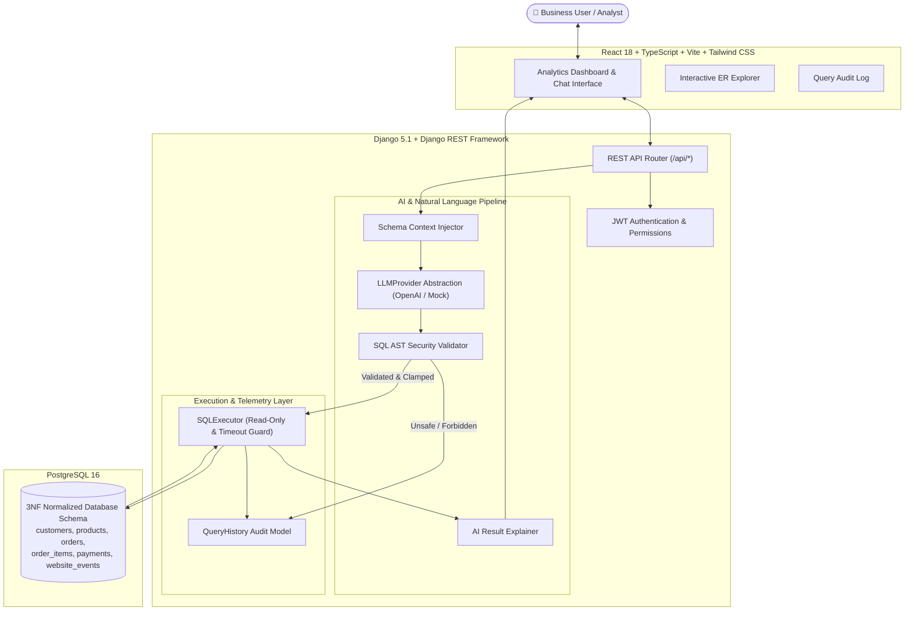

# Architecture Overview: AI Database Assistant

The **AI Database Assistant** is an enterprise-grade analytics platform that translates natural language business questions into safe, optimized, read-only SQL queries executed directly against PostgreSQL, with automatic result analysis and natural-language synthesis.

---

## 1. High-Level System Architecture



---

## 2. End-to-End Execution Dataflow

```mermaid
sequenceDiagram
    autonumber
    actor User as Business Analyst
    participant React as React UI (Vite)
    participant Django as Django REST API
    participant SchemaContext as Schema Introspector
    participant LLM as LLM Provider (OpenAI/Mock)
    participant Validator as SQL Security Validator
    participant PG as PostgreSQL Database
    participant Explainer as AI Explainer

    User->>React: Submits: "Top 10 customers by revenue in 2026"
    React->>Django: POST /api/query/ { question: "..." }
    Django->>SchemaContext: Retrieve sanitized table schema & relations
    SchemaContext-->>Django: Schema Markdown (no raw data leaked)
    Django->>LLM: generate_sql(question, schema_context)
    LLM-->>Django: Raw SQL statement
    Django->>Validator: validate(raw_sql)
    
    alt SQL Violates Security Rules (e.g., DROP, Multiple Statements, DML)
        Validator-->>Django: Invalid (error_code: UNSAFE_QUERY)
        Django-->>React: 400 Bad Request { success: false, error: {...} }
        React-->>User: Security alert & blocked query audit
    else SQL Is Safe & Read-Only
        Validator-->>Django: Validated SQL + Enforced LIMIT
        Django->>PG: BEGIN READ ONLY; SET LOCAL statement_timeout; EXECUTE;
        PG-->>Django: Result tuples & column metadata
        Django->>Explainer: explain_result(question, sql, sample_rows)
        Explainer-->>Django: Executive summary & key findings
        Django-->>React: 200 OK { sql, columns, rows, execution_time_ms, explanation }
        React-->>User: Displays syntax-highlighted SQL, Data Table, KPI badges
    end
```

---

## 3. Core Architectural Modules

### 3.1. Frontend (`frontend/src/`)
- **Technology**: React 18, TypeScript 5.5, Vite 5.4, Tailwind CSS 3.4, Recharts 2.12, Lucide React icons.
- **Components**:
  - `DashboardView`: Real-time KPIs, monthly timeseries area chart, status donut chart, geographic distribution bar chart.
  - `QueryView`: Natural language chat bar, example query pills, syntax-highlighted SQL editor, read-only security badge, data results grid with CSV export.
  - `HistoryView`: Complete query audit trail with status filters, latency inspection, and 1-click re-run.
  - `SchemaExplorerView`: Catalog of all tables, columns, constraints, and interactive visual Entity-Relationship (ER) graph.
  - `DeepAnalyticsView`: Multi-dimensional analysis covering cohort spend, catalog velocities, and timeseries metrics.
  - `SettingsView`: AI provider selector, active model display, query boundaries, and connection healthcheck.

### 3.2. AI Abstraction Layer (`backend/apps/ai_assistant/providers/`)
- Uses clean abstraction (`LLMProvider`) decoupling the generation and explanation from external vendors.
- **`OpenAIProvider`**: Connects via HTTP REST to OpenAI or any OpenAI-compatible API (Groq, Together, DeepSeek, local vLLM/Ollama).
- **`MockProvider`**: Complete deterministic offline engine that accurately parses and answers all standard portfolio business queries without external API dependencies or costs.

### 3.3. SQL Security & AST Validation Engine (`backend/apps/ai_assistant/sql_validator.py`)
- Independent multi-stage validator inspecting statement type, AST structure, comment evasion, and catalog access before any database interaction occurs.

### 3.4. Database & ORM Layer (`backend/apps/analytics/`)
- Relational 3NF design modeling customers, products, orders, order items, payments, and website telemetry events.
- Check constraints, foreign key referential integrity with appropriate cascading / protect behavior.
- Targeted composite and single-column indexes on high-cardinality foreign keys and timeseries fields.

