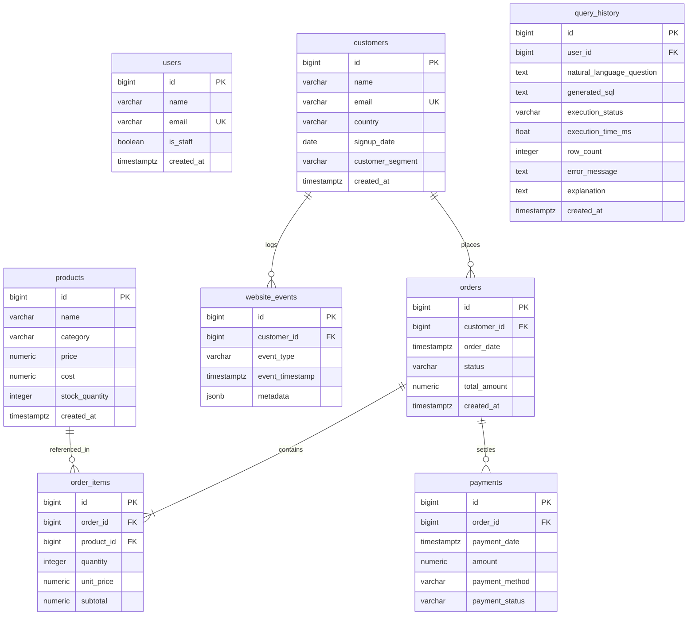

# Database Design & Relational Architecture

This document specifies the PostgreSQL relational architecture for the **AI Database Assistant**, including Third Normal Form (3NF) design decisions, entity relationships, integrity constraints, and indexing rationale.

---

## 1. Entity-Relationship (ER) Diagram

---

## 2. Table Specifications & Constraints

### 2.1. `users` (System Users & Analysts)
| Column | Type | Constraints | Description |
| :--- | :--- | :--- | :--- |
| `id` | `bigint` | `PRIMARY KEY GENERATED ALWAYS AS IDENTITY` | Unique user identifier |
| `name` | `varchar(255)` | `NOT NULL` | Full display name |
| `email` | `varchar(255)` | `NOT NULL, UNIQUE` | Unique login identifier |
| `is_staff` | `boolean` | `DEFAULT FALSE` | Administrative role flag |
| `created_at` | `timestamptz` | `NOT NULL, DEFAULT NOW()` | Account creation timestamp |

### 2.2. `customers` (CRM & Business Accounts)
| Column | Type | Constraints | Description |
| :--- | :--- | :--- | :--- |
| `id` | `bigint` | `PRIMARY KEY` | Unique customer entity ID |
| `name` | `varchar(255)` | `NOT NULL` | Company or customer contact name |
| `email` | `varchar(255)` | `NOT NULL, UNIQUE` | Customer contact email |
| `country` | `varchar(100)` | `NOT NULL` | Country of operation |
| `signup_date` | `date` | `NOT NULL` | Cohort signup date |
| `customer_segment` | `varchar(50)` | `NOT NULL, CHECK (customer_segment IN ('ENTERPRISE', 'SMB', 'CONSUMER'))` | Account tier |
| `created_at` | `timestamptz` | `NOT NULL, DEFAULT NOW()` | Record creation timestamp |

### 2.3. `products` (Catalog & Inventory)
| Column | Type | Constraints | Description |
| :--- | :--- | :--- | :--- |
| `id` | `bigint` | `PRIMARY KEY` | Unique SKU identifier |
| `name` | `varchar(255)` | `NOT NULL` | Product display name |
| `category` | `varchar(100)` | `NOT NULL` | Catalog department / category |
| `price` | `numeric(12,2)` | `NOT NULL, CHECK (price >= 0.00)` | Retail unit price (USD) |
| `cost` | `numeric(12,2)` | `NOT NULL, CHECK (cost >= 0.00)` | Unit production / wholesale cost (USD) |
| `stock_quantity` | `integer` | `NOT NULL, CHECK (stock_quantity >= 0)` | Available on-hand inventory count |
| `created_at` | `timestamptz` | `NOT NULL, DEFAULT NOW()` | Catalog creation timestamp |

### 2.4. `orders` (Transaction Headers)
| Column | Type | Constraints | Description |
| :--- | :--- | :--- | :--- |
| `id` | `bigint` | `PRIMARY KEY` | Unique transaction ID |
| `customer_id` | `bigint` | `NOT NULL, REFERENCES customers(id) ON DELETE CASCADE` | Associated customer account |
| `order_date` | `timestamptz` | `NOT NULL` | Timestamp of checkout completion |
| `status` | `varchar(50)` | `NOT NULL, CHECK (status IN ('COMPLETED', 'PENDING', 'CANCELLED', 'REFUNDED'))` | Lifecycle stage |
| `total_amount` | `numeric(12,2)` | `NOT NULL, CHECK (total_amount >= 0.00)` | Total settlement amount (USD) |
| `created_at` | `timestamptz` | `NOT NULL, DEFAULT NOW()` | Record insertion timestamp |

### 2.5. `order_items` (Transaction Line Items)
| Column | Type | Constraints | Description |
| :--- | :--- | :--- | :--- |
| `id` | `bigint` | `PRIMARY KEY` | Line item identifier |
| `order_id` | `bigint` | `NOT NULL, REFERENCES orders(id) ON DELETE CASCADE` | Parent order header |
| `product_id` | `bigint` | `NOT NULL, REFERENCES products(id) ON DELETE RESTRICT` | Associated catalog item |
| `quantity` | `integer` | `NOT NULL, CHECK (quantity > 0)` | Number of purchased items |
| `unit_price` | `numeric(12,2)` | `NOT NULL, CHECK (unit_price >= 0.00)` | Price per item at sale time |
| `subtotal` | `numeric(12,2)` | `NOT NULL, CHECK (subtotal >= 0.00)` | Calculated `quantity * unit_price` |

### 2.6. `payments` (Settlement Records)
| Column | Type | Constraints | Description |
| :--- | :--- | :--- | :--- |
| `id` | `bigint` | `PRIMARY KEY` | Financial record identifier |
| `order_id` | `bigint` | `NOT NULL, REFERENCES orders(id) ON DELETE CASCADE` | Settled order |
| `payment_date` | `timestamptz` | `NOT NULL` | Processing timestamp |
| `amount` | `numeric(12,2)` | `NOT NULL, CHECK (amount >= 0.00)` | Processed settlement sum |
| `payment_method` | `varchar(50)` | `NOT NULL, CHECK (payment_method IN ('CREDIT_CARD', 'BANK_TRANSFER', 'PAYPAL', 'STRIPE'))` | Payment rail |
| `payment_status` | `varchar(50)` | `NOT NULL, CHECK (payment_status IN ('SUCCESS', 'PENDING', 'FAILED'))` | Settlement status |

### 2.7. `website_events` (Clickstream & Telemetry)
| Column | Type | Constraints | Description |
| :--- | :--- | :--- | :--- |
| `id` | `bigint` | `PRIMARY KEY` | Telemetry event ID |
| `customer_id` | `bigint` | `NULLABLE, REFERENCES customers(id) ON DELETE SET NULL` | Visitor identity if known |
| `event_type` | `varchar(50)` | `NOT NULL, CHECK (event_type IN ('PAGE_VIEW', 'PRODUCT_VIEW', 'ADD_TO_CART', 'CHECKOUT_START', 'PURCHASE'))` | Funnel stage |
| `event_timestamp` | `timestamptz` | `NOT NULL` | Telemetry capture timestamp |
| `metadata` | `jsonb` | `DEFAULT '{}'` | Key-value browser / device telemetry |

---

## 3. Indexing Strategy & Optimization Rationale

Indexes are explicitly defined only on fields with high query frequency and filtering cardinality:

| Index Name | Table & Columns | Optimization Rationale |
| :--- | :--- | :--- |
| `idx_order_date_status` | `orders(order_date, status)` | Powers timeseries queries (`DATE_TRUNC('month', order_date) WHERE status = 'COMPLETED'`) enabling fast index-only scans without filtering table blocks sequentially. |
| `idx_order_customer_date` | `orders(customer_id, order_date)` | Optimizes Customer Lifetime Value (LTV) joins and 90-day churn detection, avoiding sequential scans on multi-thousand order datasets. |
| `idx_item_order_product` | `order_items(order_id, product_id)` | Enables nested loop / hash joins between orders and items with instant index lookup. |
| `idx_payment_status_date` | `payments(payment_status, payment_date)` | Accelerates financial reconciliation and gateway failure rate tracking. |
| `idx_event_type_timestamp` | `website_events(event_type, event_timestamp)` | Supports high-velocity event funnel analytics and drop-off rate calculations. |
| `idx_cust_country_seg` | `customers(country, customer_segment)` | Accelerates demographic segment breakdowns and country revenue grouping. |

