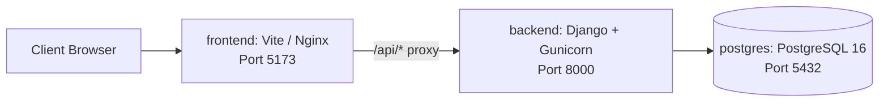

# Deployment & Infrastructure Guide

This guide details running the **AI Database Assistant** locally with Docker Compose and deploying it to production.

---

## 1. Quickstart with Docker Compose

The simplest way to run the entire stack (PostgreSQL, Django Backend, React Frontend) is with Docker Compose.

### Prerequisites
- Docker Engine 24+
- Docker Compose v2+

### Commands
```bash
# 1. Clone repository
git clone https://github.com/your-username/ai-database-assistant.git
cd ai-database-assistant

# 2. Configure environment
cp .env.example .env

# 3. Build and start all services
docker compose up --build -d

# 4. Run database migrations
docker compose exec backend python manage.py migrate

# 5. Seed realistic business analytics data
docker compose exec backend python manage.py seed_database --scale demo --seed 42
```

### Access Services
- **Web UI (React Dashboard)**: `http://localhost:5173`
- **Django REST API**: `http://localhost:8000/api/`
- **API Health Root**: `http://localhost:8000/api/`
- **PostgreSQL**: `localhost:5432` (`aidb` / `postgres:postgres`)

---

## 2. Docker Architecture



---

## 3. Production Deployment Checklist

1. **Security**:
   - Set `DEBUG=False`.
   - Generate a cryptographically secure `SECRET_KEY` (minimum 50 characters).
   - Set `ALLOWED_HOSTS` to your production domain name.
2. **Reverse Proxy & SSL**:
   - Deploy behind Nginx or AWS ALB / Cloudflare with TLS 1.3 encryption.
3. **Database**:
   - Use managed PostgreSQL (AWS RDS, GCP Cloud SQL, or Supabase).
   - Configure a dedicated read-only user for analytical execution using `database/least_privilege_setup.sql`.
4. **AI Configuration**:
   - Configure `OPENAI_API_KEY` for live LLM execution, or leave blank to operate in high-performance deterministic demo mode.

---

## 4. Least-Privilege PostgreSQL Role Setup

For defense-in-depth, configure a dedicated, unprivileged PostgreSQL user that only has `SELECT` permissions on allowed tables and columns, with column-level restrictions on `users`:

```bash
# Apply least privilege role configuration against your PostgreSQL instance
psql -h localhost -U postgres -d aidb -f database/least_privilege_setup.sql
```

Key guarantees enforced by this configuration:
- Role `app_analytics_readonly` defaults to `default_transaction_read_only = 'on'`.
- Hard execution ceiling with engine-level `statement_timeout = '10000'` (10s).
- Explicit column-level grant on `users (id, name, email, created_at)` strictly denying read access to `password_hash`.
- Revocation of file I/O routines (`pg_read_file`, `pg_ls_dir`, `pg_stat_file`).


